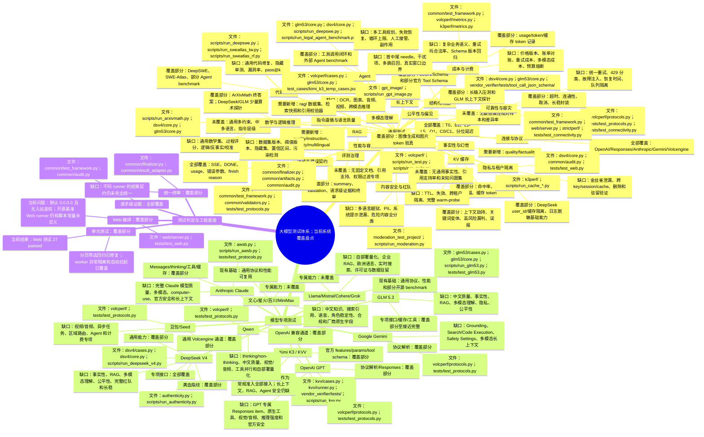

# 大模型测试覆盖思维导图

本文把《大模型通用测试与专项验收指南》映射到当前系统，标出已有测试的覆盖程度和对应文件。

## 标记说明

- **全部覆盖**：该测试方向在当前系统已有可执行用例、判定逻辑和结果产物，能够覆盖本方向已定义的范围。
- **覆盖部分**：已有相关测试，但只覆盖接口、单一场景、单一模型或少量指标，不能代表完整方向。
- **未覆盖**：当前未发现可执行的专门测试；协议解析或普通单元测试不算该模型能力已覆盖。
- **基础框架**：已有执行能力，但仍需要补充业务数据集、断言或准入规则。

## Mermaid 思维导图



## 通用测试覆盖明细

| 通用测试方向 | 覆盖状态 | 当前测试文件 | 当前覆盖内容 | 还需要补充 |
|---|---|---|---|---|
| 连接、鉴权、模型身份 | 覆盖部分 | `volcperf/connectivity.py`、`tests/test_connectivity.py`、`common/model_contracts.py` | 连通性、模型身份和基础鉴权失败 | 入站鉴权、权限矩阵、区域和路由真实性 |
| 协议与 SSE | 全部覆盖基础契约 | `volcperf/protocols.py`、`common/test_framework.py`、`tests/test_protocols.py` | 多协议解析、流式拼接、DONE、usage、finish reason | 模糊输入、分片边界、断流重连和重复事件 |
| 性能容量 | 全部覆盖既有压测范围 | `volcperf/`、`k3perf/`、`strictperf/`、`scripts/run_suite.py` | 闭环、开环、分档负载、缓存压测、长稳封装 | 故障注入、统一重试、恢复时间和租户公平性 |
| 缓存 | 覆盖部分 | `k3perf/`、`dsv4/core.py`、`glm53/core.py` | 命中 token、命中率、公共前缀、Session | TTL、失效、跨租户隔离、缓存污染、warm-probe |
| 指令遵循 | 未覆盖 | 无独立质量 runner | 仅有少量固定 prompt | 多约束、否定约束、指令层级、格式遵循数据集 |
| 多语言 | 未覆盖 | 无独立质量 runner | 协议层 Unicode 可传输 | 中英混合、繁体、日文、术语和语言切换评分 |
| 数学/逻辑 | 覆盖部分 | `scripts/run_arxivmath.py`、`dsv4/core.py`、`glm53/core.py` | ArXivMath 最终答案、少量算术 | 通用数学、逻辑、多跳、过程和置信校准 |
| 事实性/幻觉 | 未覆盖 | 无独立质量 runner | 没有事实性判定集 | 可核验来源、引用支持、未知问题和时效性 |
| 代码 | 覆盖部分 | `scripts/run_deepswe.py`、`scripts/run_sweatlas_tw.py`、`scripts/run_sweatlas_rf.py` | 官方代码 Agent benchmark | 通用代码修复、隐藏单测、漏洞率、pass@k |
| 结构化输出 | 覆盖部分 | `dsv4/core.py`、`glm53/core.py`、`vendor_verifier/tests/tool_call_json_schema/` | JSON、工具 Schema、部分严格校验 | 复杂业务 Schema、语义校验、重试后稳定性 |
| 长上下文 | 覆盖部分 | `volcperf/cases.py`、`glm53/core.py`、`test_cases/kimi_k3_temp_cases.json` | 多档输入长度和长上下文响应 | Needle、多跳、干扰项、窗口边界和压缩记忆 |
| 多模态理解 | 覆盖部分 | `gpt_image/`、`vendor_verifier/tests/prompt_tokens/` | 图像生成、图片 token、部分图片 token fixture | OCR、图表、空间关系、音频、视频和跨模态推理 |
| RAG | 未覆盖 | 无独立 RAG runner | 无固定文档和引用验证 | 检索召回、groundedness、引用精确率、权限过滤 |
| Agent | 覆盖部分 | `dsv4/core.py`、`glm53/core.py`、`scripts/run_legal_agent_benchmark.py` | 单/多轮工具回传和 Agent benchmark | 规划、并行工具、失败恢复、循环限制和副作用 |
| 内容安全 | 覆盖部分 | `moderation_test_project/`、`moderation_keywords/`、`scripts/run_moderation.py` | 劫持、关键词变体、高风险漏判和误报 | 完整有害内容分类、越狱、多语言、间接注入 |
| 隐私与隔离 | 覆盖部分 | `dsv4/core.py`、`common/audit.py`、`tests/test_web.py` | user_id/cache 隔离和日志脱敏 | PII、金丝雀、跨 key/session、删除、驻留和缓存隔离 |
| 公平性 | 未覆盖 | 无对应测试文件 | 无 | 敏感属性成对样本、差异率、贬损率和拒答差异 |
| 成本计费 | 覆盖部分 | `common/test_framework.py`、`volcperf/metrics.py`、`k3perf/metrics.py` | token、缓存 token、usage 统计 | 价格表版本、账单对账、重试/多模态成本和预算告警 |
| 版本回归 | 覆盖部分 | `tests/`、`results/`、`web/aggregation.py` | 结果留存和批次聚合 | 数据/阈值/prompt 版本、隐藏集、置信区间和显著性 |

## 模型专项覆盖明细

| 模型或模型家族 | 通用测试 | 自身专项 | 覆盖结论 | 对应文件 |
|---|---|---|---|---|
| DeepSeek V4 | 性能、协议、SSE、usage、缓存、工具 | 思考模式、reasoning、Strict Tool、Prefix/FIM、Responses、Anthropic、指纹 | **专项接口全部覆盖；通用能力部分覆盖** | `dsv4/cases.py`、`dsv4/core.py`、`scripts/run_deepseek_v4.py`、`authenticity.py`、`scripts/run_authenticity.py` |
| GLM 5.3 | 性能、协议、SSE、usage、长上下文 | thinking、JSON、工具链、缓存、Session、指纹、Agent | **专项部分覆盖，接口重点较完整** | `glm53/cases.py`、`glm53/core.py`、`scripts/run_glm53.py`、`tests/test_glm53.py` |
| Kimi K3 | 性能、OpenAI 兼容、缓存基础 | 官方 KVV features、params、tool JSON Schema、prompt token | **官方套件部分覆盖** | `kvv/cases.py`、`kvv/runner.py`、`vendor_verifier/tests/`、`scripts/run_kvv.py` |
| Claude/Anthropic | Anthropic 协议、SSE、usage、工具基础 | Messages、thinking、工具流式、缓存、Claude Opus 特征 | **覆盖部分** | `awsb.py`、`scripts/run_awsb.py`、`tests/test_protocols.py` |
| OpenAI GPT | OpenAI Chat/Responses 协议和性能基础 | 无完整 GPT 家族专项 | **通用协议部分覆盖，模型专项未覆盖** | `volcperf/protocols.py`、`tests/test_protocols.py` |
| Gemini | Gemini 协议解析和通用性能基础 | 无 Search/Grounding/Safety Settings 专项 | **通用协议部分覆盖，模型专项未覆盖** | `volcperf/protocols.py`、`tests/test_protocols.py` |
| Qwen | OpenAI 兼容、性能和基础结构化输出 | 无 Qwen thinking/视觉/量化专项 | **通用部分覆盖，专项未覆盖** | `volcperf/`、`tests/test_protocols.py` |
| 豆包/Seed | Volcengine 协议、性能、限流观察 | 无完整视频/音频/异步 Agent 专项 | **通用部分覆盖，专项未覆盖** | `volcperf/`、`tests/test_protocols.py` |
| 文心/星火 | 通用协议和性能能力可复用 | 中文知识、搜索引用、语音、行业安全 | **专项未覆盖** | 当前无对应专项文件 |
| Llama/Mistral | 通用协议、性能、部分代码 benchmark | 自部署、量化、许可证、边缘延迟和多语言 | **专项未覆盖** | 当前无对应专项文件 |
| Cohere/Grok | 通用协议基础可复用 | 企业 RAG、重排、实时搜索、引用和地区路由 | **专项未覆盖** | 当前无对应专项文件 |

## 最需要新增的测试树

```text
quality/
├── instruction/          # 指令遵循、层级冲突、多约束
├── multilingual/         # 中文、多语言、术语保持
├── factuality/           # 事实性、引用、未知问题
├── reasoning/            # 数学、逻辑、多跳、置信校准
├── code/                 # 编译、隐藏单测、漏洞和 pass@k
├── long_context/         # Needle、干扰项、窗口边界
├── multimodal/           # OCR、图表、音频、视频、跨模态
├── rag/                  # 检索、引用、权限、冲突文档
├── agent/                # 规划、工具、恢复、循环、副作用
├── safety/               # 越狱、注入、有害内容、隐私、偏见
└── governance/           # 数据版本、阈值、置信区间、隐藏集
```

建议优先新增 `quality/instruction`、`quality/factuality`、`quality/long_context`、`quality/rag`、`quality/safety` 五组；它们是当前系统从“接口兼容性验收”走向“模型能力验收”最明显的缺口。

## 当前工程问题对测试结论的影响

| 问题 | 证据 | 影响 |
|---|---|---|
| Web 开源基准脚本分发未完成 | `web/server.py` 引用未定义的 `ARXIVMATH_SCRIPT`、`DEEPSWE_SCRIPT` 等常量 | 5 个开源基准可走 CLI，但从 UI 提交会失败；worker 会将异常任务标记为 failed，不再永久卡住队列 |
| 限流与模型失败混合 | `results/KVV_TOOL_SCHEMA-20260923-144007/summary.json` 中 69 条失败包含 HTTP 429 | 可能把配额或限流误判成模型能力失败 |
| 默认监听不安全 | `start.sh:41` 默认 `0.0.0.0`；Web 接口未见入站鉴权 | 可被未授权提交任务、读取报告和消耗 API 额度 |
| 临时缓存案例不可执行 | `README.md` 记载 `CACHE-HIT-10` 等案例缺少 messages，需要 warm→probe 执行器 | 缓存 TTL、失效和命中结论不完整 |
| 结果契约仍有差异 | `common/finalizer.py`、各领域 runner 的 summary 字段不同 | 跨模型、跨 runner 横向比较成本较高 |

## 推荐验收顺序

1. 先补齐开源基准 Web runner、鉴权和 429 分类，保证测试平台自身可信。
2. 增加指令遵循、事实性、长上下文、RAG 和安全数据集。
3. 将工具调用扩展为完整 Agent 沙箱测试。
4. 增加视觉、音频、视频理解测试。
5. 建立数据集版本、阈值版本、隐藏集和置信区间。
6. 再为 OpenAI、Gemini、Qwen、豆包、文心、星火、Llama、Mistral 等模型建立专属 Profile。
